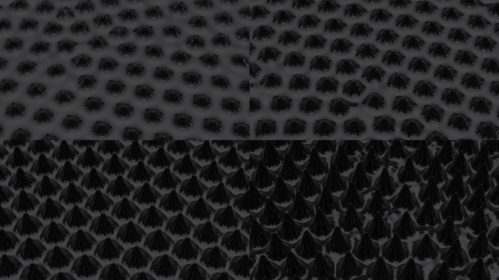
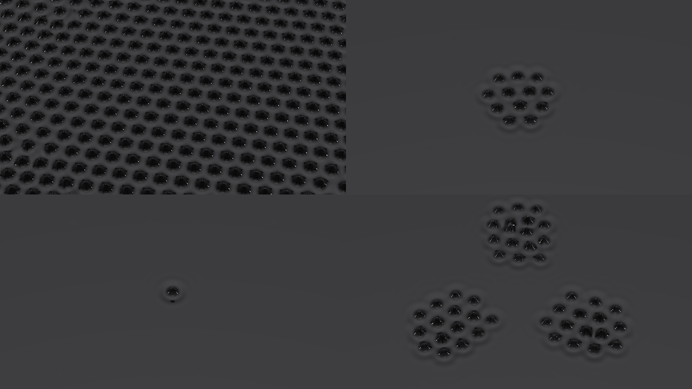
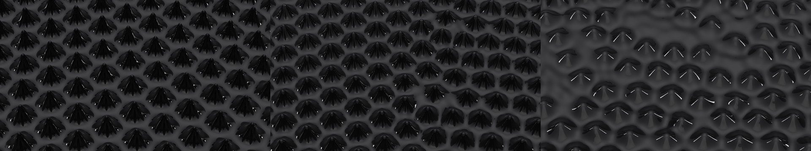
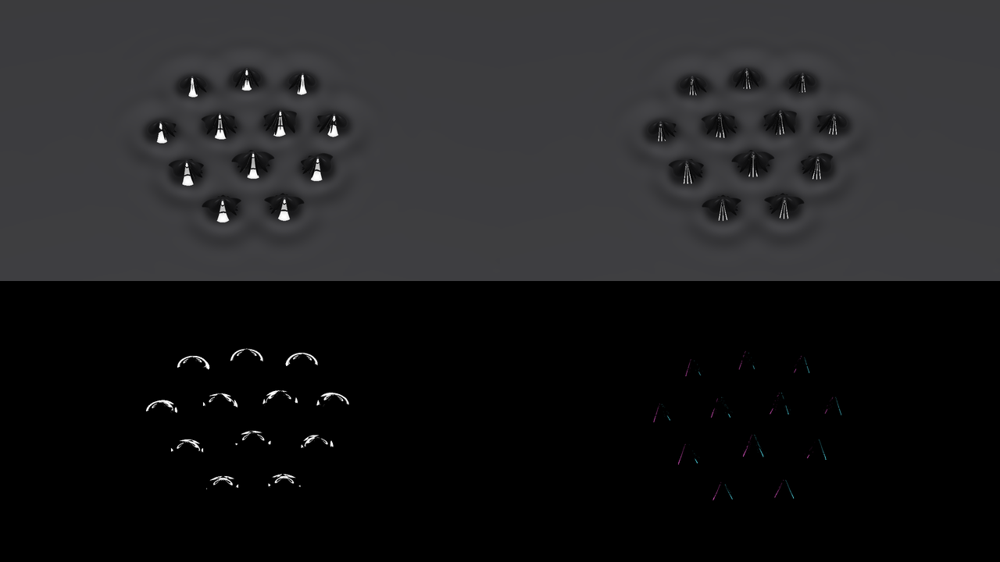
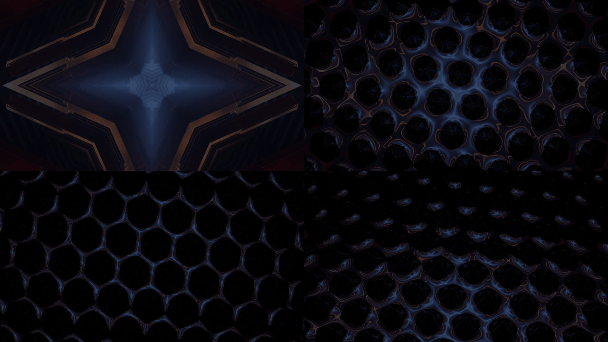

# Ferrofluid user guide

Ferrofluid is **ferrofluid spikes on the beat, for [Resolume](https://resolume.com) Arena and
Avenue**, as two FFGL plugins in one download: **SW Ferrofluid**, a source, which is a dish of
ferrofluid in a photographer's studio, and **SW Ferro Over**, an effect, which is the same pool with
your clip hung on a screen above it, broken up in its mirror.

Ferrofluid is oil full of magnetite particles about ten nanometres across. Put it in a magnetic
field and it magnetises; push the field past a critical value and the flat surface gives up and
stands in spikes, all at once, on a hexagonal lattice. That's the Rosensweig instability, worked out
by Cowley and Rosensweig in 1967, and it's why people pay good money for a jar of black oil and a
magnet to keep on their desk. The plugins are the whole rig: an electromagnet whose current is the
music, a pool of a real fluid off a datasheet, and a camera looking down at it. Nothing draws a
spike. The pool's surface follows the physics, the spikes come up when the current crosses onset,
and what you see is whatever the fluid, a black mirror, happens to reflect.


*Rendered by `fetest`, the offline harness, rather than captured from Resolume. Top left, SW
Ferrofluid at its defaults 3.1 seconds in, a tenth of a second into a beat's kick. Top right, the
Helmholtz pair (Magnet *Uniform*) held at 1.5 critical currents with Fire On *Off*, seen from 60°
under *Backlight* on a *Black* backdrop, five seconds in. Bottom left, *Three Coils* with Fire On
*Off*, Gain 0.3 critical currents and Field Width 20 cm, following the harness's synthetic music
(a kick every half second and a busy hi-hat), five seconds in. Bottom right, SW Ferro Over at its
defaults on a frame of Resolume's own IntoTheGlow_02 clip, 3.1 seconds in. Each panel is a whole
1280 × 720 frame at half size.*

> **Before you rely on this:** it's at **v0.1.0**, the first release, and early days. It has been
> loaded into **Resolume Arena 7.28.1 on macOS**: both plugins register (`SW Ferrofluid`, `FE01`, a <!-- ARENA -->
> source; `SW Ferro Over`, `FE02`, an effect), the controls change Arena's output, all of them but <!-- ARENA -->
> Audio, Band and Threshold, which need sound, and the Over at Mix 0 is bit for bit the clip with <!-- ARENA -->
> the effect bypassed. No sound reached it there. <!-- ARENA -->
> Nothing has been run on Windows: the Windows download is built by the release pipeline and hasn't
> been loaded into anything yet. <!-- ARENA -->
>
> Everything else was measured offline by a harness (`fetest`) that drives the plugins' own class
> in a headless GL context on an Apple M4 Max, and `tools/verify.sh` passes (20 October 2026), at
> 1280×720 and 320×180 on the GPU and four of its checks again on Apple's software renderer. Every
> mode of the surface rings or grows at the Cowley–Rosensweig rate to 1.3e-5 of its height. The flat
> pool goes unstable between 12.003 and 12.033 A against the theory's 12.018 A, and the harness
> reproduces a published critical field (Mahr and Rehberg's 5.9 kA/m). The settled lattice sits at
> the critical wavelength, with three peaks 60.7°, 56.1° and 63.2° apart. The spikes jump up at onset
> and hang on below it down to the model's own fold, to within a sweep step. Each spike's shape is
> solved offline with the full nonlinear magnetostatics, and the solver matches Gollwitzer et al.'s
> measured pattern amplitudes to within 1.1%. Twenty-one models broken on purpose and sixteen
> one-character changes to the shipped code are all caught, and all 20 controls of each plugin that
> have pixels change the picture.
>
> What isn't solved is where the spikes stand and how far they've grown: that's a chosen model,
> fitted to the solver, and over a single coil held past onset it lays down rows of spikes where a
> real pool would make hexagons (*Known limits*). No real audio has reached it anywhere, only the
> harness's synthetic kicks, and I haven't seen how Fire On follows Arena's transport. <!-- ARENA -->
> There's a browser demo at
> [ferrofluid-demo.stoatworks-labs.com](https://ferrofluid-demo.stoatworks-labs.com/), which has no
> audio. Try it on a spare layer before you put it in a show.
>
> This codebase was created with AI assistance, directed and reviewed by a human author.

---

## Installing

Every download has both plugins in it: **SW Ferrofluid** (a source) and **SW Ferro Over** (an
effect), as `Ferrofluid.bundle` and `Ferrofluid Over.bundle` on macOS and `Ferrofluid.dll` and
`Ferrofluid Over.dll` on Windows. Get them from the
[`v0.1.0` release on GitHub](https://github.com/stoatworks-labs/ferrofluid/releases/tag/v0.1.0)
or the [project page](https://stoatworks-labs.com/software/ferrofluid/), drop both into
Resolume's effects folder and restart Resolume:

```
macOS    ~/Documents/Resolume Arena/Extra Effects/
Windows  %USERPROFILE%\Documents\Resolume Arena\Extra Effects\
```

Avenue uses the same layout under its own folder name. SW Ferrofluid shows up among the sources and
SW Ferro Over in the effects browser. <!-- ARENA -->

The macOS download is a universal build (Apple silicon and Intel), as a `.dmg` or a `.zip`. It's
**Developer ID-signed and notarised** by the release pipeline after publication, so the bundles
just load. If macOS refuses a download, it's from before the signing, so download it again. The
Windows download is an x64 installer (`-setup.exe`) or a `.zip`. It isn't code-signed, so the
installer trips SmartScreen once: **More info** → **Run anyway**.

---

## Start here

1. Put **SW Ferrofluid** in a clip slot and trigger it. That's a grey studio, a dish of Ferrotec's
   EFH1 seen from 35°, and a coil under the middle of it. On the first beat of Resolume's tempo a
   hexagonal patch of black spikes stands up over the coil, and on every beat after that the spikes
   swell and settle back.
2. Stop Resolume's transport. The spikes stay. Press **Settle** and the pool goes flat, and stays <!-- ARENA -->
   flat until the transport starts again. That's not a fault, and *How the pool works* says why.
3. Change **Magnet** to *Uniform*. The coil becomes a Helmholtz pair, the field is the same
   everywhere, and the next beat stands the whole pool up at once.
4. Change **Lights** to *Backlight* and **Backdrop** to *Black*, and turn **Tilt** up to 1. That's
   the classic ferrofluid photograph: black spikes, each picked out by a thin rim of light.
5. Turn **Bias** up past 0.67 (one critical current). The pool spikes with no beat at all, and the
   further past 0.67 you go, the taller the spikes, but the spacing between them doesn't change.
6. For your own footage, put **SW Ferro Over** on a clip. The clip is on a screen just above the
   pool, so while the pool is flat you see the clip; on the first beat it breaks into a lattice of
   dark discs with a web of the clip's light between them.

---

## How the pool works

### The drive

The coil is asked for a current, and everything the plugins do starts there:

```
current asked for = Bias + Gain × (the music's level + the pulses on now)
```

**Bias** is the steady part. **Gain** is how hard the rest pushes: each pulse adds one Gain, and
the music adds Gain times the level of its band (0 to 1). A pulse comes from a beat, an onset in
the audio or a press of **Fire**, and lasts **Pulse**. The coil can't follow instantly: its current
gets there through its own lag, **Coil Lag**, the coil's L/R. The whole thing is clamped at 1.6
critical currents.

**Bias and Gain are in critical currents**, not amps. One critical current (I_c) is the current at
which the fluid's surface over the magnet's strongest point goes unstable. In amps that moves by a
factor of six between the fluids and magnets, so a slider in amps would put the interesting bit
somewhere different every time you changed fluid. In critical currents, 1 is always onset, and
Resolume's slider shows it at 0.667. The amps behind it, at the default coil size and spread:

| fluid | Uniform (Helmholtz pair) | Coil | Three Coils (each) | λ_c | applied field at onset |
| --- | --- | --- | --- | --- | --- |
| EFH1 | 12.02 A | 3.52 A | 3.94 A | 9.82 mm | 8.60 kA/m (10.8 mT) |
| EMG 901 | 17.27 A | 5.05 A | 5.66 A | 8.81 mm | 12.36 kA/m (15.5 mT) |
| EMG 909 | 21.60 A | 6.32 A | 7.07 A | 10.23 mm | 15.46 kA/m (19.4 mT) |

### Onset, and the spikes hanging on

Below one critical current the pool is flat, whatever the music does. Above it, ripples of one
wavelength (λ_c, about a centimetre) grow, and the surface stands up in spikes on a hexagonal
lattice that far apart. Louder pushes them taller, not closer together.

The onset is subcritical: the spikes come up with a jump, to 4.5 mm for EFH1, and once up they
survive until the current falls well below where they appeared, to the **fold**. Between the two
the pool can be flat or spiked, and which you get depends on what happened last.

| fluid | the fold | a spike at onset | at 1.5 I_c |
| --- | --- | --- | --- |
| EFH1 | 0.928 I_c (Bias 0.619) | 4.48 mm | 11.15 mm |
| EMG 901 | 0.976 I_c (Bias 0.651) | 2.33 mm | 8.49 mm |
| EMG 909 | 0.995 I_c (Bias 0.664) | 0.93 mm | 5.57 mm |

The heights are the solved spike's, peak above the pool's mean level; the harness holds the drawn
spikes to them to 0.3%.

The default Bias, 0.98 I_c, sits inside EFH1's loop. The flat pool stays flat until a beat kicks the
current past onset, the spikes jump up, and when the pulse ends they hang on, swelling on every beat
after. EMG 901's fold is 0.976, so 0.98 is only just inside it, and its spikes sit low between
beats. EMG 909's loop is narrower than that, so its spikes fall between kicks: that's the fluid,
not a setting to tune round.

In the harness, with EFH1 in the Helmholtz pair and the beats stopped, the spikes held at Bias 0.93
I_c and collapsed at 0.92. Over the default coil they're slower to go: at 0.92 they were still
standing seven seconds later, and at 0.90 they were down to ripples.

### A stopped transport is a flat pool

With **Fire On** at *Beat*, the default, the kicks are Resolume's beats. Stop the transport and the
beats stop, the coil settles at Bias, just under onset, and a flat pool stays flat however long you
wait. It's the physics doing its job, but it looks like a broken plugin. Start the
transport, press **Fire**, set Fire On to *Onset* with some audio routed, or turn Bias up past
0.67.

Two wrinkles:

- **Spikes that are already up hang on** when the transport stops, because 0.98 is inside the loop.
  In the harness they were still standing ten seconds after the last beat. Press **Settle**, or take
  Bias under 0.6 (0.9 I_c).
- **A host whose bar phase never moves gets a beat of the plugin's own**, at the host's tempo, so
  that Fire On is never dead. The plugin switches to following the transport the first time it sees
  the bar phase move, and from then on a stopped transport means no beats. I haven't seen what
  Resolume sends while its transport is stopped. If it keeps sending the same bar phase, a clip
  triggered while the transport is already stopped will spike on the plugin's own beat until the
  transport has run once. <!-- ARENA -->

---

## The Drive group

Resolume shows every slider as 0 to 1. The ranges below are what the slider positions mean, and
where a slider is geometric (each step along multiplies rather than adds), a table gives a few
positions.

**Fire On** (*Off*, *Beat*, *Half Beat*, *2 Beats*, *Bar*, *Onset*; default *Beat*). What fires a
pulse. *Beat* is every beat of Resolume's tempo, *Half Beat* every quaver, *2 Beats* every other
beat and *Bar* the first beat of each bar of four. A beat's pulse starts at the moment inside the
frame where the beat fell, not at the frame's start: the harness has every pulse within 1.8e-15 s
of its beat at 120 and 97 BPM. *Onset* fires on hits in the audio (see **Threshold**), and an
onset's pulse is as tall as the hit was hard, from 0 to 1 Gain. *Off* fires nothing but **Fire**.

**Fire** (a button). One pulse, now, whatever Fire On says. It acts on the press, so holding it
does nothing more. Whether a press shows depends on Bias. A pulse has to hold the current past onset
long enough for spikes to grow out of the noise, and a short, small one doesn't. Then, once they're
up, they only stay if Bias is inside the loop. At the default Bias, 0.98 I_c, the default press
(Gain 0.2 I_c for 150 ms) raises the patch and it stays. From 0.9 I_c, below EFH1's fold, the same
press does nothing visible at all, and looks for all the world like a dead button. Measured in the
harness from a flat pool, EFH1 over the default coil: the tallest spike after one press, then
what's left of it four seconds after the press (under a millimetre is ripples):

| Bias, Gain (I_c) | Pulse 150 ms (0.588) | Pulse 300 ms (0.739) | Pulse 1 s (1) |
| --- | --- | --- | --- |
| 0.9, 0.2 | nothing | 4.3 → 0.1 mm | 6.0 → 0.2 mm |
| 0.9, 0.3 | 3.7 → 0.1 mm | 5.3 → 1.8 mm | 7.2 → 0.3 mm |
| 0.9, 0.5 | 5.2 → 2.2 mm | 8.8 → 0.6 mm | 9.3 → 0.3 mm |
| 0.98, 0.1 | nothing | 5.0 → 4.1 mm | 5.8 → 4.1 mm |
| 0.98, 0.2 (the defaults) | 4.3 → 4.1 mm | 6.0 → 4.1 mm | 6.7 → 3.7 mm |

At 0.98 the patch stays at about 4 mm; at 0.9 it goes, though close to the fold it can take a few
seconds about it. So for a press that shows and then goes away, take Bias below the fold and give
the pulse more Gain or more length: Gain 0.5 I_c with a 1 s Pulse from 0.9 I_c raised spikes in
Arena on macOS too. <!-- ARENA --> For one that shows and stays, keep Bias inside the loop. A press
in the first few frames after the clip is triggered can do nothing either: the coil starts from
nothing and is still coming up to Bias.

**Audio** (Resolume's FFT input). The music. Resolume should offer it as a choice of audio source;
I haven't seen how it shows it. <!-- ARENA --> With nothing routed, the band levels are 0 and
*Onset* never fires.

**Band** (*Low*, *Mid*, *High*, *Full*; default *Low*). Which part of the spectrum the coil follows.
Of Resolume's 64 bins, Low is the first sixteenth, Mid up to a quarter and High the rest. Each band
is measured against its own recent peak, so a quiet band still moves the coil, and a long loud
passage reads as 1 throughout. Nobody has measured where Resolume's bins sit in frequency. The
level is added to the drive all the time, in every Fire On mode, so with music routed the coil
follows the band and the pulses ride on top. Band does nothing with *Three Coils*, which follow
Low, Mid and High one each, or with no audio.

**Gain** (0 to 1.5 I_c; default 0.2, at 0.133). How hard the pulses and the music push: a pulse
adds Gain, the band's level adds Gain times the level. At the default Pulse and Coil Lag a beat
peaks at about 1.17 I_c. Gain 0.05 never raised a spike in ten seconds of beats in the harness;
0.1 did.

**Bias** (0 to 1.5 I_c; default 0.98, at 0.653). The steady current. 1 I_c, at 0.667, is onset;
above it the pool spikes with no beat at all, and below the fluid's fold (see the table above) the
spikes can't hang on.

| I_c | 0.5 | 0.9 | 0.93 | 0.98 | 1 | 1.05 | 1.1 | 1.2 | 1.5 |
| --- | --- | --- | --- | --- | --- | --- | --- | --- | --- |
| slider (Bias, Gain) | 0.333 | 0.6 | 0.62 | 0.653 | 0.667 | 0.7 | 0.733 | 0.8 | 1 |



*EFH1 in the Helmholtz pair (Magnet* Uniform*) with Fire On* Off*, five seconds in, SW Ferrofluid
otherwise at its defaults, rendered by `fetest` rather than captured from Resolume. Top left, Bias
1.02 I_c; top right 1.1; bottom left 1.3; bottom right 1.5. The spikes measure 4.8, 5.9, 8.5 and
11.4 mm tall. Each panel is a whole 1280 × 720 frame at half size.*

**Coil Lag** (1 to 300 ms, geometrically; default 40 ms, at 0.647). The coil's L/R: how long its
current takes to follow what it's asked for. A 150 ms pulse through the default 40 ms gets almost
all the way up; through 300 ms it gets 39% of the way, and the harness's beat peaked at 1.07 I_c
instead of 1.17.

**Threshold** (0 to 1; default 0.4). How far a hit must rise above the recent average before
*Onset* fires: at 0 a little over it, at 1 three and a half times it. On the harness's music, with
a hi-hat that changes every frame, turning Threshold from 0 to 1 cut the onsets that weren't kicks
from 84 to 33 in ten seconds. It only matters for Fire On *Onset*.

**Pulse** (10 ms to 1 s, geometrically; default 150 ms, at 0.588). How long each pulse lasts.
Pulses that overlap add up: at 120 BPM on *Beat*, a Pulse of 500 ms holds the coil at Bias + Gain
the whole time, and 1 s holds it at Bias + 2 × Gain. A short pulse through a slow coil does very
little. At the default Gain and Coil Lag, pulses of 10 and 30 ms raised nothing in ten seconds.

| ms | 1 | 5 | 10 | 20 | 40 | 50 | 100 | 150 | 250 | 300 | 500 | 1000 |
| --- | --- | --- | --- | --- | --- | --- | --- | --- | --- | --- | --- | --- |
| Coil Lag | 0 | 0.282 | 0.404 | 0.525 | 0.647 | | 0.807 | | | 1 | | |
| Pulse | | | 0 | | | 0.349 | 0.5 | 0.588 | 0.699 | | 0.849 | 1 |

---

## The Magnet group

**Magnet** (*Uniform*, *Coil*, *Three Coils*; default *Coil* in the source, *Uniform* in the Over).
*Uniform* is a Helmholtz pair (two 200-turn coils 20 cm across), so the field is the same over the
whole pool and the whole pool spikes. *Coil* is one solenoid (400 turns over 40 mm) under the
middle of the frame, its top 13 mm below the surface. Its field is strongest over its middle, so
the spikes start there and the patch spreads outward as the current rises. *Three Coils* are three
of those on a triangle, each following its own band: Low on the far side, Mid on the left and High
on the right. Every pulse goes to all three.

**Coil Size** (5 mm to 8 cm, geometrically; default 4 cm, at 0.75). The solenoid's radius. At the
defaults, coils of 5 mm to 2 cm raise one spike; 8 cm raises a field of them. It does nothing with
*Uniform*.

**Coil Spread** (2 to 30 cm, geometrically; default 8 cm, at 0.512). The side of *Three Coils*'
triangle. At 2 cm the three patches are one. It does nothing with one coil or with *Uniform*.
**Keep it at 12 cm or under.** The pool is only 21 cm deep (EFH1; less for EMG 901), and past about
12 cm the far coil's patch runs off its edge: the harness shows it cut off in a straight line at 16
cm, a stub of three spikes at 20 cm and nothing at all at 30. That's a bug in this release (*Known
limits*).

| cm | 0.5 | 1 | 2 | 4 | 8 | 12 | 15 | 20 | 30 |
| --- | --- | --- | --- | --- | --- | --- | --- | --- | --- |
| Coil Size | 0 | 0.25 | 0.5 | 0.75 | 1 | | | | |
| Coil Spread | | | 0 | 0.256 | 0.512 | 0.662 | 0.744 | 0.85 | 1 |



*The magnets, each at Bias 1.05 I_c with Fire On* Off*, Field Width 20 cm, five seconds in, SW
Ferrofluid otherwise at its defaults, rendered by `fetest` rather than captured from Resolume. Top
left* Uniform*; top right* Coil *at the default 4 cm; bottom left* Coil *with Coil Size 1 cm;
bottom right* Three Coils *at the default 8 cm spread. Each panel is a whole 1280 × 720 frame at
half size.*

---

## The Fluid group

**Fluid** (*EFH1*, *EMG 901*, *EMG 909*; default *EFH1*). Which fluid is in the dish, each from its
datasheet: Ferrotec's EFH1 from their 2010 technical data sheet, EMG 901 and EMG 909 from Mahr and
Rehberg (1998), whose numbers are complete. They differ in what matters here: EFH1's spikes are
tallest and its loop widest, EMG 909's spikes are low, round and fall between kicks at the default
Bias (the tables under *How the pool works*). Each fluid's pool is its own, so **changing Fluid
starts a fresh, flat pool**.



*The three fluids in the Helmholtz pair at Bias 1.2 I_c with Fire On* Off*, ten seconds in, SW
Ferrofluid otherwise at its defaults, rendered by `fetest` rather than captured from Resolume. Left
to right, EFH1, EMG 901 and EMG 909, their spikes 7.0, 5.1 and 3.7 mm tall. Each panel is a whole
1280 × 720 frame at half size.*

**Viscosity** (a quarter to 100 times the datasheet's, geometrically; default 1×, at 0.231). How
thick the fluid is. Thicker is slower: at 100× the default beats raised nothing in three seconds and
a full patch by fifteen. Thinner rings more.

**Noise** (0, then 1 µPa to 0.1 Pa, geometrically; default 1 mPa, at 0.6). A faint random pressure
on the surface, the floor every spike grows from. At 0 (the slider right at the bottom) there's
nothing to grow from, and the pool stays flat however hard it's driven: the harness held it at 1.2
I_c for ten seconds and nothing moved. Turned down, it takes longer to get going: at 1 µPa the
default beats raised nothing in three seconds. Turned up, it doesn't make the surface visibly rough
below onset.

**Settle** (a button). Flattens the pool, now. On the next beat, at the defaults, the spikes come
back.

| | 0 | 0.116 | 0.2 | 0.231 | 0.4 | 0.415 | 0.6 | 0.616 | 0.799 | 0.8 | 1 |
| --- | --- | --- | --- | --- | --- | --- | --- | --- | --- | --- | --- |
| Viscosity | 0.25× | 0.5× | | 1× | | 3× | | 10× | 30× | | 100× |
| Noise | none | | 10 µPa | | 0.1 mPa | | 1 mPa | | | 10 mPa | 0.1 Pa |

---

## The View group

The camera is a 100 mm lens, the product photographer's choice, looking at the middle of the pool.

**Field Width** (2 to 40 cm, geometrically; default 10 cm, at 0.537). How wide the frame is at the
pool. At 2 cm one spike fills it. *Three Coils* at the default spread want about 20 cm, or their
patches are cut off at the frame's edges. The pool itself is 42 × 21 cm for EFH1 (38 × 19 for
EMG 901, 44 × 22 for EMG 909) and repeats beyond its edges, so a wide frame tilted well over can
take in more than one pool's depth: at 40 cm and a Tilt of 60°, a coil's patch is there twice.

| cm | 2 | 5 | 10 | 15 | 20 | 30 | 40 |
| --- | --- | --- | --- | --- | --- | --- | --- |
| slider | 0 | 0.306 | 0.537 | 0.673 | 0.769 | 0.904 | 1 |

**Tilt** (0° to 60°; default 35° in the source, at 0.583, and 0° in the Over). How far the camera
leans from straight down, towards you, so the far side of the pool is the top of the frame. Straight
down a spike is a dark disc; from 60° it's a cone.

**Height** (SW Ferro Over only; 2 cm to 1 m, geometrically; default 4 cm, at 0.177). See *SW Ferro
Over* below.

**Exposure** (−4 to +4 stops; default 0, at the middle). The fluid reflects about 4.5% of the light
that hits it straight on, so at 0 stops that's made up: a soft box, or the Over's clip, seen
straight on in a flat pool shows at its own brightness. Each stop doubles it.

**Lights** (SW Ferrofluid only: *Soft Box*, *Two Boxes*, *Strips*, *Backlight*, *Window*, *Neon*,
*Rim*; default *Rim*). The studio. A mirror shows you the lights, not the fluid, so this is most of
the look. *Soft Box* is one big box overhead, a little behind the camera, and puts a broad white
stripe down every spike. *Two Boxes* is a key and a dimmer fill either side. *Strips* is three tall
strip boxes. *Backlight* is a wide low panel beyond the pool, which every spike's outline catches as
a bright rim. *Window* is a warm four-pane window. *Neon* is a magenta strip and a cyan one. *Rim*,
the default, is two tall strips low on either side and a dim fill overhead, so each spike carries a
thin line of light down its flanks, as in product photographs of ferrofluid.

**Backdrop** (SW Ferrofluid only: *Black*, *Studio*; default *Studio*). What the rest of the studio
is. *Studio* is a dim seamless sweep, brighter overhead, and it's what makes the flat pool grey.
*Black* leaves nothing but the lights: on *Rim* that's very nearly a black frame.



*SW Ferrofluid at Bias 1.05 I_c with Fire On* Off*, five seconds in, otherwise at its defaults,
rendered by `fetest` rather than captured from Resolume. Top left* Soft Box*, top right* Strips*,
both on* Studio*; bottom left* Backlight *and bottom right* Neon*, both on* Black*. Each panel is a
whole 1280 × 720 frame at half size.*

**Mix** (SW Ferro Over only; 0 to 1, default 1). See below.

SW Ferrofluid's output is opaque everywhere: the studio fills the frame.

---

## SW Ferro Over: your clip above the pool

The Over is the same pool with your clip on a screen hanging **Height** above it, facing down. The
screen shows the clip mirrored, the way a teleprompter's monitor does, so a flat pool's reflection
reads the right way round. Past the screen's edge is a dark room. It starts in the Helmholtz pair,
seen straight down, so the whole frame is pool.

- **A flat pool is your clip.** The screen is sized to fill the frame, so with nothing spiking you
  see your clip as it is, whatever Height and Field Width say. In the harness, with the fluid's
  reflectance forced to 1, not one channel of 3,686,400 differed from the clip in 8 bits.
- **A spike is a small curved mirror.** Its steep flanks throw the clip's light away from the
  camera, so from above each spike is a dark disc with a pinpoint of the clip at its tip, and the
  troughs between spikes catch the clip in a web of bright lines.
- **Height** (2 cm to 1 m, geometrically; default 4 cm, at 0.177) is how far the screen hangs above
  the pool. Higher throws each tilted bit of surface further across the screen: at 2 cm a lot of
  the clip survives between the spikes, at 15 cm it's a web of thin lines, and at 1 m only the
  flattest troughs see it at all.
- **Tilt** works as in the source, but the screen doesn't follow it: lean the camera over and the
  far part of the pool reflects the dark room beyond the screen's edge. At 35° the top of the frame
  goes dark; at 60° a flat pool shows only a sliver of the clip along the bottom.
- **Mix** (0 to 1, default 1) is the whole effect against your clip. At 1 the output is opaque
  wherever your clip was transparent, because a picture of a pool is; at 0 you get your clip back
  bit for bit, alpha included.

At the defaults the first beat breaks the whole picture up and, Bias being inside the loop, it stays
broken. For a clip that's whole between hits, see *Recipes*.



*SW Ferro Over on a frame of Resolume's IntoTheGlow_02 clip, five seconds in, otherwise at its
defaults, rendered by `fetest` rather than captured from Resolume. Top left, Fire On* Off*: the
flat pool. The other three at Bias 1.05 I_c with Fire On* Off*: top right Height 2 cm, bottom left
Height 15 cm, bottom right Tilt 35° at the default Height. Each panel is a whole 1280 × 720 frame
at half size.*

---

## Recipes

Each of these was run in the harness, with its synthetic beat at 120 BPM or its synthetic music
(a kick every half second over a busy hi-hat) standing in for Resolume's.

**The photograph.** SW Ferrofluid, Magnet *Uniform*, Fire On *Off*, Bias 0.7 (1.05 I_c), Tilt
0.75 (45°), Lights *Two Boxes*. The pool comes up of its own accord within half a second and settles
into a field of spikes, each with two hard white highlights down its near flank and its
neighbours reflected round its base.

**A forest.** Magnet *Uniform*, Fire On *Off*, Bias 1 (1.5 I_c), Tilt 1, Lights *Backlight*,
Backdrop *Black*: tall sharp cones as far as you can see, each outlined in light (the top right of
the picture at the top of this guide).

**A hit on cue.** Fire On *Off*, Bias 0.567 (0.85 I_c, below every fluid's fold), Gain 0.267 (0.4),
Pulse 1 (one second), and **Fire** mapped to a pad or a MIDI note. Each press stands the spikes up
in under a fifth of a second and holds them for the second; within half a second of the pulse
ending they're down to ripples. On SW Ferro Over it breaks the clip up on the hit and gives it back
afterwards.

**The clip, broken on the one.** SW Ferro Over, Fire On *Bar*, Bias 0.567 (0.85 I_c), Gain 0.267
(0.4), Pulse 0.849 (500 ms). On the first beat of every bar the clip shatters into the lattice for
half a second, then wobbles back together; at 120 BPM it's whole again, give or take a ripple,
well before the next bar. On *Beat* the gaps are too short for the spikes to fall all the way.

**Breathing with the bass.** Route the audio, then Fire On *Off*, Band *Low*, Magnet *Uniform*, Bias
0.533 (0.8 I_c) and Gain 0.333 (0.5). The coil follows the kick drum: with the harness's music the
current ran between 0.99 and 1.15 I_c and the spikes swelled from 4.3 to 6.4 mm on every kick. Since
each band is measured against its own recent peak, a busy track keeps the level high, and the
spikes rarely go all the way down.

**Three coils, three bands.** Route the audio, then Magnet *Three Coils*, Field Width 0.769 (20
cm), Fire On *Off* and Gain 0.2 (0.3 I_c). The far patch follows the low end, the left one the
mids and the right one the top. On the harness's music the hi-hat kept the right-hand patch the
tallest (the bottom left of the picture at the top). Keep Coil Spread at 12 cm or under.

**A slow swell.** Fire On *Bar*, Bias 0.6 (0.9 I_c), Gain 0.2 (0.3), Pulse 1 (one second), Coil Lag
1 (300 ms) and Viscosity 0.799 (30×). The coil drags and the fluid's thick, so after the first bar
the spikes swell over the first second of each bar, to about 7 mm, and sink back to about 2 mm
over the second, never quite gone.

---

## Time and tempo

The pool's waves have frequencies in hertz, so the plugins run on the host's clock. For the first
few frames after loading they run on a clock of their own while they work out whether the host
counts in seconds or milliseconds (Resolume has been seen to send both); after that, every frame
moves the pool on by the host's time since the last, in double precision. A frame longer than a
tenth of a second only passes a tenth of a second, so a stall doesn't arrive as one enormous kick.
If the host's clock stops, the pool stops where it is, spikes and all. Which of Resolume's clocks
that is, and whether stopping the transport stops it, I haven't seen. <!-- ARENA -->

The beats come from the host's bar phase, and *A stopped transport is a flat pool* says what happens
when it doesn't move. Changing the composition's size keeps the pool as it was: the harness checks
that a pool that changes raster mid-run is identical, to the byte, to one that started at the new
raster.

---

## How it works

Every host frame:

1. **The drive**, on the CPU: which pulses fired inside the frame and when, the music's level, and
   the coil's current through its lag, in closed form.
2. **The magnet and the fluid**, on the CPU: the field each coil makes (a real loop's, summed over
   the winding), and the fluid's magnetisation along its Langevin curve, from which the stress that
   pulls the surface up.
3. **The pool**, on the GPU: a 512 × 256 grid, twelve cells to a critical wavelength, whatever the
   raster, held as its spectrum. Each wave is moved on by the linear theory's own solution, and a
   chosen nonlinear stress (the pattern engine) decides where the spikes stand and how far they've
   grown. It takes as many substeps a frame as stability needs: 12 at the defaults, up to 48.
4. **The spikes**, on the GPU: every spike the pool has raised is replaced by the real fluid's
   spike at the field it stands in, solved offline with the full nonlinear magnetostatics and
   shipped as a table, scaled by how far the pool's spike has grown.
5. **The light**, on the GPU: each pixel's ray is followed to that surface, reflected with the
   exact Fresnel reflectance of the fluid, followed for one more bounce off a neighbouring spike,
   and sent on to the studio's lights or the Over's screen. The neighbours' dark reflections round
   each spike's base are that second bounce, and they're most of what makes photographs of
   ferrofluid look the way they do.

---

## Performance

GPU time measured by the offline harness (`fetest --bench`) on an Apple M4 Max, the median of 120
frames, on 20 October 2026. The GPU was busy with other work at the time:

| plugin | moment | 720p | 1080p | 4K |
| --- | --- | --- | --- | --- |
| SW Ferrofluid | defaults | 8.40 ms | 7.45 ms | 12.5 ms |
| SW Ferro Over | defaults | 10.0 ms | 12.1 ms | 22.7 ms |
| SW Ferrofluid | Three Coils, from 60° | 9.5 ms | 10.7 ms | 16.5 ms |

That's about half a 60 fps frame at 720p for the source, and more than a whole one for the Over at
4K, so give it a machine with room to spare. A quiet run on 15 October, before the solved spikes,
gave the source 4.0, 4.4 and 6.2 ms. Most of the cost is the pool, which costs the same at any
raster (about 150 passes a frame), and it grows with the drive: the defaults take 12 substeps a
frame at 60 fps, 1.5 I_c takes 31 in the Helmholtz pair and 36 over a coil, and the drive's 1.6 I_c
ceiling 43.

At 30 fps each frame needs twice the substeps, and past about 1.4 I_c the pool can't take enough:
it runs slow, by up to a third at the very top of the drive, and says so in the log. Nothing was
timed inside Resolume, and nothing was timed on Windows.

---

## If it looks wrong

**The pool is flat.** Something isn't getting the current past onset:

- the transport is stopped (*A stopped transport is a flat pool*);
- Fire On is *Off*, or *Onset* with no audio routed;
- you're pressing **Fire** with Bias below the fold and the default Gain and Pulse, which isn't
  enough to raise anything (the table under **Fire**);
- Gain is too low (under about 0.067, which is 0.1 I_c, at the defaults), or Pulse is too short for
  the Coil Lag;
- Noise is right at 0;
- Viscosity is high, and it's on its way: give it a while;
- the Fluid is EMG 909, whose spikes fall between kicks at the default Bias.

**The spikes won't go away.** Bias is inside the fluid's loop, so they hang on. Press **Settle**, or
take Bias under 0.6 (0.9 I_c).

**A row of spikes instead of a hexagonal patch.** Over a coil held past onset, at around 1.1 to
1.3 I_c, the pattern lays down as stripes, and each stripe is drawn as a row of spikes. It's a
limit of the model (*Known limits*). The default, biased under onset and kicked past it, comes up as
hexagons, and so does anything in the Helmholtz pair.

**A Three Coils patch is cut off in a straight line, or missing.** Coil Spread is over about 12 cm.
Turn it down. If the patches are only cut off at the frame's edge, turn Field Width up to about 0.77
(20 cm).

**The same patch is there twice.** Field Width is wide and Tilt is high, and the frame takes in
more than the pool. Turn one of them down.

**Changing Fluid flattened everything.** It does: each fluid is its own pool.

**The Over is mostly black.** The spikes are throwing the clip away from the camera, which is what
they do. Lower Height, lower the drive, or turn Exposure up. If it's the top of the frame that's
black, Tilt is up and you're seeing past the screen's far edge.

**It runs in slow motion.** The frame rate is low and the drive is high, and the pool can't keep
up. The log says `substep cap`. Lower the drive or raise the frame rate.

**Neither plugin is in the browser.** Check the folder under *Installing*, and that Resolume was
restarted.

**It does nothing at all.** That's what a shader that won't compile looks like. The error is in the
log:

```
macOS    ~/Library/Logs/ferrofluid/ferrofluid.YYYY-MM-DD.log
Windows  %LOCALAPPDATA%\ferrofluid\logs\ferrofluid.YYYY-MM-DD.log
```

It records the GL vendor, renderer and version at load, which shader failed if one did, whether the
pool's buffers couldn't be allocated, each fluid's critical wavelength and current, and when the
pool falls behind real time.

---

## Known limits

- **In Resolume only on macOS**, in Arena 7.28.1 with no sound, and nothing run on Windows. For <!-- ARENA -->
  what was checked there, see the box at the top. <!-- ARENA -->
- **No real audio** has reached it, only the harness's synthetic kicks, and nobody has measured what
  Resolume's FFT bins hold, so Band and Threshold are untested against music.
- **Where the spikes stand and how far they've grown is a chosen model.** The shape of each spike
  is solved; the pattern engine that places them is a chosen nonlinear stress with two constants
  fitted per fluid, so that its fold and its spike height at onset are the solver's. Growing and
  collapsing spikes are the equilibrium spike scaled down, not the real dynamics. A spike without
  all six neighbours (at a patch's edge, or in a defect) gets a shape the solver never saw. Each
  spike takes the field at its centre, normal component only, so a coil's tangential field, which
  stretches real spikes into ridges at its edge, is left out.
- **Over a coil held past onset the pattern is rolls, not hexagons.** At 1.125 or 1.3 I_c held for
  ten seconds over the default coil the patch lays down as stripes, drawn as rows of spikes, which
  no real pool does. It's marginal (a slightly longer time step gave hexagons at 1.3) and still
  open. In the Helmholtz pair it's hexagons.
- **EFH1's table stops at 1.566 I_c**, where the solver's grid gives out under the sharpest tips.
  The drive's last few hundredths draw that spike.
- **Coil Spread past about 12 cm is broken.** The pool is 21 cm deep for EFH1 and repeats at its
  edges, but the coils' field doesn't, so the far coil's patch is cut off at the pool's edge, and
  past about 18 cm that coil raises nothing at all. A 30 cm triangle can't fit a 21 cm pool, so the
  fix (a narrower range, or a bigger pool) is a decision for a later release.
- **The pool is about 42 × 21 cm and repeats**, so a wide, steeply tilted frame shows it twice.
- **The Over's screen is finite**, and doesn't follow Tilt: beyond it is a dark room.
- **At 30 fps and a hard drive the pool runs slow**, by up to a third, to stay stable.
- **Assumed rather than measured:** the fluid's optical constants (magnetite in oil), a deep layer,
  and the coils' hardware (plausible, not anyone's real rig).
- **Only ever measured on an Apple M4 Max** and Apple's software renderer, although the macOS build has
  an Intel slice.
- **No presets and no OpenFX version.**
- **There is a browser demo** at
  [ferrofluid-demo.stoatworks-labs.com](https://ferrofluid-demo.stoatworks-labs.com/). It's a port to
  a web page, not the plugin itself, and it has no audio.

---

## About

The last group, **About**, has the plugins' name, version, licence and maker, and buttons that open
this guide, the project page, the source on GitHub and the support page in your browser.

## Links

- Project page: [stoatworks-labs.com/software/ferrofluid](https://stoatworks-labs.com/software/ferrofluid/)
- Source: [github.com/stoatworks-labs/ferrofluid](https://github.com/stoatworks-labs/ferrofluid)
- User guide: [stoatworks-labs.com/software/ferrofluid/guide](https://stoatworks-labs.com/software/ferrofluid/guide/)
- Browser demo: [ferrofluid-demo.stoatworks-labs.com](https://ferrofluid-demo.stoatworks-labs.com/)

## Reporting something

If something's wrong, shout at
[github.com/stoatworks-labs/ferrofluid/issues](https://github.com/stoatworks-labs/ferrofluid/issues).
A screenshot, the Magnet, Fluid, Bias, Gain and Fire On, whether the transport was running, any
other controls you moved, and the composition's resolution and frame rate are usually enough. If
the plugin did nothing, attach the log.

The instability is Cowley and Rosensweig's (1967); the solved spikes are checked against Gollwitzer,
Matthies, Richter, Rehberg and Tobiska (2007), and the critical field against Mahr and Rehberg
(1998). The full list of the work it stands on is in
[ATTRIBUTIONS.md](https://github.com/stoatworks-labs/ferrofluid/blob/main/ATTRIBUTIONS.md).
